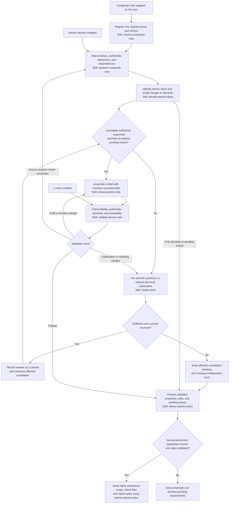

# Zettelkasten AI Note Helper

This diagram describes the specified workflow. Routing follows processing state and preconditions: clarification is conditional, and a pending candidate does not block independent candidates.

## Purpose

Zettelkasten AI Note Helper specifies an agent that curates composite notes and extracts atomic notes while preserving the user's wording, meaning, and authorship. It supports the transition from reading notes or mixed collections of ideas to independent notes that can be reused in a Zettelkasten.

An **atomic note** centers on one relevant idea, is understandable on its own, and is traceable to its source. It may contain several paragraphs and express a definition, argument, distinction, relationship, or observation. Atomicity does not mean creating a note for every sentence.

## What the agent does

- Registers the original material and its version without modifying the main file.
- Separates personal elaboration, quotations, references, questions, and incomplete or uncertain fragments.
- Identifies independently reusable ideas and the excerpts that support them.
- Requests clarification when meaning, authorship, or necessary elaboration is missing.
- Assembles proposed notes with supported titles, minimal edits, and explicit source references.
- Validates each proposal and presents its sources, edits, and unresolved issues.
- Saves validated notes only under current authorization and reports their destinations.

For example, if a reading note contains three ideas and one lacks a necessary explanation, the agent can prepare proposals for the other two while asking the user to develop the third. It records the user's answer as source material and reassesses the affected candidate before extraction and validation.

## Authorship and source fidelity

The [agent specification](agents/zettelkasten.json) defines the non-negotiable rules inherited by every skill:

- Do not invent concepts, examples, premises, explanations, or conclusions on the user's behalf.
- Preserve meaning, including negations, qualifications, certainty, and causal relationships.
- Ask the user for substantial rewriting or missing elaboration.
- Keep quotations identified and separate from personal elaboration; an isolated quotation requires the user's elaboration.
- Trace title and body claims to supporting excerpts. Internal agent analysis is not an authored source.
- Expose material ambiguity and disclose every textual edit.
- Preserve the main source file and available references without inventing missing metadata.

By default, sources are limited to the main file and the user's answers in the current processing session. Explicit preferences can adjust negotiable defaults, such as spelling corrections, titles, or authorized sources, but cannot suspend non-negotiable rules during processing.

Configuration is written in English. Interaction follows the user's language, while notes and recorded answers retain their original language and wording.

## Agent and skills

The [Zettelkasten agent](agents/zettelkasten.json) defines the objective, governance, editorial policy, data contracts, states, skill routing, completion conditions, and file policy.

| Stage | Skill specification | Responsibility |
| --- | --- | --- |
| Receive | [receive-composite-note](skills/receive-composite-note.json) | Check readability and register the source, version, and available metadata. |
| Analyze | [analyze-composite-note](skills/analyze-composite-note.json) | Classify excerpts and map authorship, references, dependencies, and uncertainties. |
| Identify | [identify-atomic-ideas](skills/identify-atomic-ideas.json) | Identify supported candidates and justify relevance, grouping, and discards. |
| Clarify | [clarify-notes](skills/clarify-notes.json) | Ask targeted questions and record the user's own elaboration as new source material. |
| Extract | [extract-atomic-note](skills/extract-atomic-note.json) | Assemble a draft, source support map, and edit log. |
| Validate | [validate-atomic-note](skills/validate-atomic-note.json) | Check fidelity, authorship, atomicity, and traceability; route failures for correction. |
| Deliver | [deliver-atomic-notes](skills/deliver-atomic-notes.json) | Present proposals and pending issues, and perform authorized saves. |

Validation does not constitute user approval. A clarification answer does not imply saving authorization. Changed sources require reanalysis of affected excerpts, and every note edit requires validation again.

## Expected results

Processing can produce proposed notes with titles and bodies, identified quotations, source references, claim support, edit logs, and validation results. It also reports candidates awaiting clarification or rewriting and relevant discards with their rationale.

Analysis can be delivered with pending questions clearly disclosed. Extraction must not be declared complete while candidates await required answers. Saving is complete only when authorized notes have been validated, written to known destinations, and checked, with paths reported.

## Current implementation status

This repository contains **declarative JSON specifications** for one agent and seven skills. The files do not execute actions themselves. There is currently no executor, installation command, or runtime test suite included.

An executor would need to load the specifications, maintain sources and processing state, enforce validation and authorization, and perform file operations. The specifications do not establish an implemented integration with a note-taking application or a complete system for maintaining and exploring a network of notes. Suggested connections must be supported by authorized material.

## Maintaining the project

Read [AGENTS.md](AGENTS.md) before changing the agent or skills. It defines scope boundaries, protection of non-negotiable rules, English-language requirements for project artifacts, versioning, consistency checks, and delivery expectations.

Every modified agent or skill JSON must receive an appropriate `MAJOR.MINOR.PATCH` version increment. Documentation-only changes do not require bumps in untouched JSON files.
